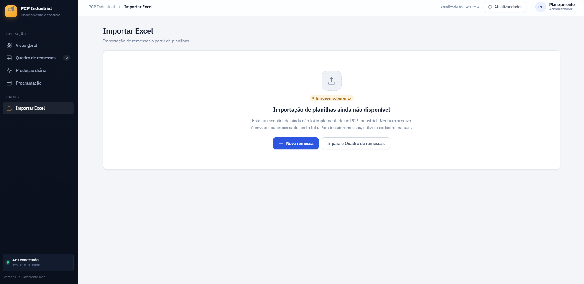
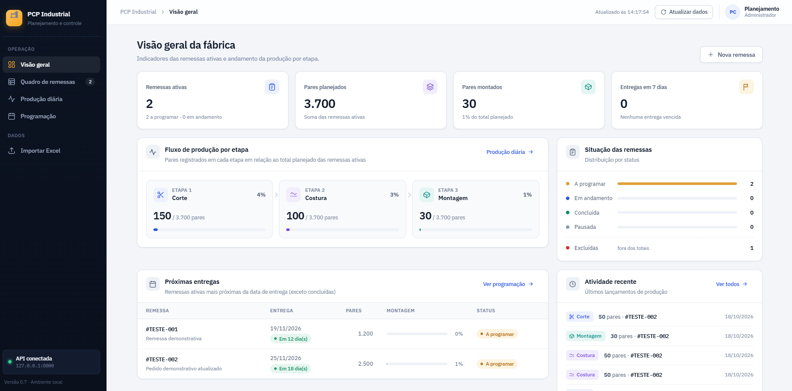
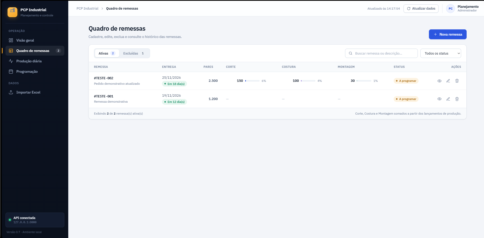
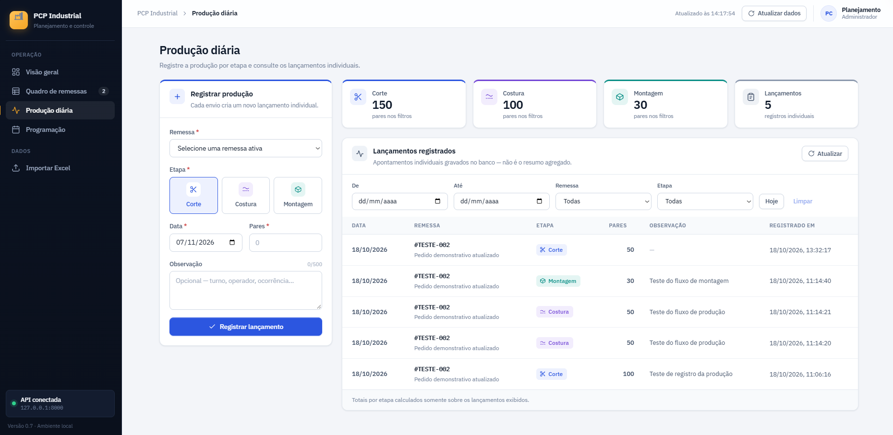
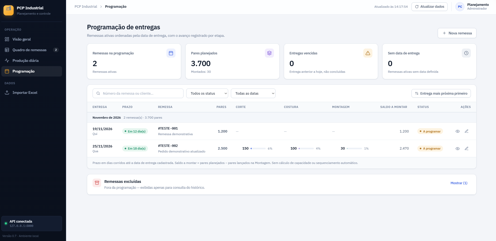

# PCP Industrial

Sistema web de **Planejamento e Controle da Produção (PCP)** desenvolvido para apoiar o acompanhamento de remessas, programação de entregas e controle da produção por etapa em uma fábrica de calçados.

O projeto nasceu da experiência com processos reais de PCP industrial, nos quais informações de produção e programação são frequentemente organizadas por meio de planilhas e atualizações manuais.

O objetivo é centralizar essas informações em uma aplicação, facilitar o acompanhamento das remessas e fornecer uma visão mais clara do andamento da produção.

---

## Visão geral

O PCP Industrial reúne informações importantes para o planejamento e acompanhamento da produção:

- Remessas ativas e excluídas;
- Quantidade de pares planejados;
- Registro de produção por etapa;
- Acompanhamento do saldo a montar;
- Programação de entregas;
- Indicadores de produção;
- Histórico de lançamentos.

---

## Telas do sistema

### Visão geral

Dashboard com indicadores das remessas ativas, pares planejados, avanço da produção por etapa e próximas entregas.



### Quadro de remessas

Tela para cadastrar, consultar, editar e acompanhar remessas, com status e progresso das etapas de produção.



### Produção diária

Registro individual da produção por etapa: corte, costura e montagem. Os lançamentos são associados às remessas para acompanhar o avanço produtivo.



### Programação

Visualização das remessas organizadas por data de entrega, com quantidade de pares planejados, avanço por etapa e saldo a montar.



### Importação de Excel

A tela de importação está disponível visualmente, mas o processamento de planilhas ainda está em desenvolvimento. Atualmente, as remessas podem ser cadastradas manualmente.



---

## Funcionalidades

- Cadastro e edição de remessas;
- Consulta de remessas ativas e excluídas;
- Registro de produção por etapa;
- Acompanhamento de corte, costura e montagem;
- Cálculo do saldo a montar;
- Programação por data de entrega;
- Indicadores gerais de produção;
- Histórico de lançamentos;
- Persistência de dados em banco SQLite;
- Comunicação entre frontend e backend por API.

---

## Tecnologias utilizadas

### Frontend
- React
- Vite
- JavaScript
- CSS

### Backend
- Python
- FastAPI
- SQLite

---

## Arquitetura

A aplicação utiliza uma arquitetura separada entre frontend e backend.

- **Frontend:** interface de usuário desenvolvida em React;
- **Backend:** API desenvolvida com FastAPI;
- **Banco de dados:** SQLite para armazenamento das informações.

O frontend consome os endpoints da API para consultar e registrar dados de produção e remessas.

---

## Como executar localmente

### Pré-requisitos

- Node.js
- Python
- Git

### 1. Clonar o repositório

```bash
git clone https://github.com/Ruanrobert/PCP.git
cd PCP
```

### 2. Executar o backend

Entre na pasta do backend:

```powershell
cd backend
```

Ative o ambiente virtual:

```powershell
.\.venv\Scripts\Activate.ps1
```

Inicie a API:

```powershell
python -m uvicorn main:app --reload --port 8000
```

A API estará disponível em:

```text
http://127.0.0.1:8000
```

Documentação interativa da API:

```text
http://127.0.0.1:8000/docs
```

### 3. Executar o frontend

Abra outro terminal na pasta raiz do projeto e execute:

```bash
npm install
npm run dev
```

O Vite exibirá o endereço local para acessar a aplicação, normalmente:

```text
http://localhost:5173
```

---

## Status do projeto

O PCP Industrial está em desenvolvimento.

### Implementado
- Interface principal;
- Quadro de remessas;
- Cadastro e gerenciamento de remessas;
- Registro de produção por etapa;
- Programação de entregas;
- Indicadores e acompanhamento do avanço produtivo;
- Integração com API FastAPI;
- Persistência em SQLite.

### Em desenvolvimento
- Importação e processamento de planilhas Excel;
- Automatização de etapas do planejamento;
- Evolução das regras de programação industrial.

---

## Objetivo

Desenvolver uma ferramenta que ajude a transformar processos manuais de planejamento e controle da produção em um fluxo mais organizado, visual e confiável.

O projeto também é uma oportunidade de aplicar conhecimentos de desenvolvimento web, integração de sistemas, banco de dados e automação de processos industriais.

---

## Autor

**Ruan Robert de Oliveira**

GitHub: [@Ruanrobert](https://github.com/Ruanrobert)