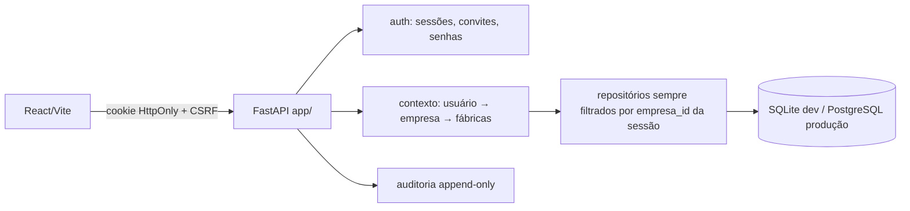

# Fase 1 — Auditoria e Plano Técnico do PCP Industrial SaaS

Data: 18/10/2026 · Backup desta fase: `backups/2026-10-18_fase1-auditoria_150032/` (integrity_check ok, 37 arquivos conferidos por SHA-256)

## 1. Estado atual (auditado)

| Item | Situação |
|---|---|
| Frontend | React 19 + Vite, `src/App.jsx` concentra estado e chamadas; 5 páginas + 5 componentes |
| Backend | `backend/main.py` (FastAPI 0.3.0), **sem autenticação**, CORS só localhost:5173 |
| Banco | SQLite `backend/pcp.db`, `user_version=0`, 4 tabelas + sqlite_sequence |
| Hash do banco | `09c9c731…f4142ec` — **idêntico** ao do backup pré-SaaS (nenhuma alteração desde 13:55) |
| Etapas | Fixas em 3 lugares: CHECK do banco, regex do Pydantic, `ETAPAS` no frontend (+6 componentes) |
| Remessa | `numero` UNIQUE global — incompatível com a realidade (mesma remessa 600/601/602/700 existe nas fábricas 22, 23 e 24) |
| Importar Excel | Tela informativa, sem implementação |
| `backend/app/` | Esboço de sessão anterior: `config.py` e `db.py` íntegros; **`migrations.py` corrompido (100% bytes nulos)** |

### Contratos da API atuais (serão mantidos com as mesmas URLs, agora autenticados e filtrados por empresa)
`GET /api/health` · `GET/POST /api/remessas` · `PUT/DELETE /api/remessas/{id}` (DELETE lógico) ·
`GET /api/remessas/{id}/historico` · `GET/POST /api/producao` · `GET /api/producao/resumo` ·
`DELETE /api/producao/{id}` (físico — passará a ser **estorno lógico auditado**).

### Dados reais
| Tabela | Registros |
|---|---|
| remessas | 3 (TESTE-001, TESTE-002, Teste-003 = Excluída) |
| producao_diaria | 5 (todos na TESTE-002) |
| historico_remessas | 12 |

TESTE-002: Corte **#1 = 100** e **#5 = 50**, Costura **#2 = 50** e **#3 = 50**, Montagem **#4 = 30**.

## 2. Arquivos de referência encontrados

`Downloads/QUADRO DE REMESSAS VALENTE.xlsx` — planilha **manual de fechamento**, não o relatório exportado do sistema:
- Abas `QUADRO OUTUBRO`, `FAB 7`, `FAB 14`: colunas `SEMANA · FABRICA · Remessas · Total · Enf · Av. Pré · Av. Palm · Tiras · Corte · Costura · Talon · Palmilha · Sola · Pré · Distrib. · Mont. · Exped. · ETOQ/PEDIDO · DATA EMBARQUE · FAT.`
- Fábricas presentes: **7, 14, 22, 23, 24, 95**.
- Subtotais por quinzena com `SUBTOTAL(9,…)`, total mensal com `SUM`, linha "Dias".
- Valores por seção **parecem ser saldo pendente** (ex.: Rem. 602, total 540 → Sola 18, Pré 18, Distrib 18, Mont 27, Exped 27; remessas encerradas = tudo 0). **Precisa de confirmação.**
- Abas auxiliares: `PRE PROD`, `PALM`, `AV. PRE` (por linha/modelo), `Planilha1` (Remessa · Op · Linha · Modelo · quantidade).

> [!IMPORTANT]
> O relatório do sistema de origem com `Remessa::Tipo Rem.`, `Remessa::Nr.`, `Remessa::OP`, `Pedido`, `Composição::Descrição`, `Qtd.Total` e as datas de leitura por seção **não está no computador**. As fases 5 e 6 (importação e leituras) dependem desse arquivo.

## 3. Arquitetura proposta

**Monólito modular** (um FastAPI, um banco), sem microsserviços.

### Isolamento multiempresa
- Banco compartilhado, `empresa_id` em toda tabela de cliente; o `empresa_id` vem **sempre da sessão**, nunca do corpo/URL.
- Fábrica informada pelo cliente é validada: pertence à empresa **e** o usuário tem acesso a ela.
- Recursos de outra empresa respondem **404** (não revela existência).
- Defesa em profundidade: triggers no SQLite garantem que remessa/OP/leitura e fábrica sejam da mesma empresa; no PostgreSQL, **Row Level Security**.

### Autenticação
- Senha com **scrypt** (biblioteca padrão do Python, sem nova dependência), salt por usuário.
- Sessão opaca aleatória em cookie HttpOnly/SameSite; só o hash do token fica no banco; expiração e revogação.
- Proteção CSRF (token duplo em cabeçalho), limite de tentativas por conta e por IP.
- Convites e redefinição: token de uso único, guardado como hash, com validade.
- **Administrador geral só é criado por comando local** (`python -m app.cli criar-admin`, senha digitada no terminal). Nenhuma rota da API concede esse papel.
- E-mail: interface `EmailService`; sem provedor configurado, o convite gera um **link para copiar** e a tela diz explicitamente "e-mail não enviado".

### Papéis
`admin_geral` (plataforma) · `admin_empresa` · `pcp` · `consulta`, com acesso por fábrica (`todas` ou lista).

### Planos e assinaturas
`planos` (nome, preço opcional e configurável, limites de usuários/fábricas/funcionalidades) e `assinaturas` (estado, início, fim do teste, vencimento). Sem cobrança real.

| Estado | Comportamento proposto |
|---|---|
| teste / ativa | Acesso normal |
| vencida | Somente leitura e exportação durante carência configurável |
| suspensa | Login bloqueado para usuários da empresa; dados preservados |
| cancelada | Igual a suspensa; reativação apenas pelo admin geral |

## 4. Modelo de dados (novas tabelas e alterações)

| Tabela | Finalidade / chave de unicidade |
|---|---|
| `empresas` | clientes da plataforma |
| `usuarios`, `usuario_fabricas`, `sessoes`, `convites`, `tentativas_login` | acesso |
| `planos`, `assinaturas` | comercial |
| `fabricas` | `UNIQUE(empresa_id, codigo)` |
| `etapas` | catálogo por empresa, `UNIQUE(empresa_id, codigo)`; nome, cor, ativa |
| `fabrica_etapas` | fluxo por fábrica: ordem, ativa |
| `remessas` (alterada) | + `empresa_id`, `fabrica_id`; `UNIQUE(empresa_id, fabrica_id, numero)` |
| `ops` | `UNIQUE(remessa_id, numero_op)`; pedido, material, qtd prevista |
| `producao_diaria` (alterada) | + `empresa_id`, `etapa_id`, `op_id`, `origem='manual'`, estorno lógico; **CHECK de 3 etapas removido** |
| `importacoes`, `importacao_linhas` | arquivo, SHA-256, prévia, mapeamento, resultado |
| `leituras` | leitura importada por OP/etapa; `UNIQUE(empresa_id, chave_origem)` → reimportação não duplica |
| `auditoria` | append-only (triggers bloqueiam UPDATE/DELETE) |

Alterar UNIQUE e CHECK no SQLite exige reconstruir `remessas` e `producao_diaria`. A migração copia **preservando os IDs** (1–3 e 1–5), confere contagens e o conteúdo da TESTE-002 linha a linha, e aborta tudo (transação) se algo divergir.

### Migrações
Numeradas, controladas por `PRAGMA user_version`, executadas **somente por comando explícito** com caminho do banco; backup automático antes; validação depois. Reversão = restauração do backup (documentada) — o SQLite não desfaz reconstruções de tabela de forma segura.

## 5. Regras de produção (rascunho para aprovação)
- **Leitura ≠ conclusão**: leitura sem quantidade mostra data e existência, sem calcular saldo.
- Estados da OP por etapa: Sem leitura · Pendente · Em andamento · Parcialmente concluída · Concluída · Com divergência (regras detalhadas na Fase 6, após ver o relatório real).
- **Conciliação manual × importado**: nunca soma automática. Os dois ficam separados com origem; quando houver ambos para a mesma OP/etapa/data, o sistema mostra divergência para revisão humana.

## 6. Fases e dependências

| Fase | Pode começar? | Depende de |
|---|---|---|
| 2 Empresas, usuários, fábricas, isolamento | ✅ em cópia do banco | decisão sobre dono dos dados antigos (só para migrar o real) |
| 3 Login, convites, painel admin | ✅ | — |
| 4 Fábricas e etapas configuráveis | ✅ | — |
| 5 Importação Excel | ⚠️ parcial | **arquivo exportado do sistema de origem** |
| 6 Leituras e consulta de OP | ⚠️ parcial | arquivo de origem + regras de conclusão |
| 7 Fechamento semanal/mensal | ⚠️ parcial | confirmar o significado das colunas da planilha VALENTE |
| 8 Segurança, regressão, implantação | ✅ ao final | — |

## 7. Produção / hospedagem (recomendação, nada será contratado)
PostgreSQL gerenciado (transações concorrentes, backup com recuperação pontual, RLS) + backend em contêiner + frontend estático, HTTPS automático, segredos em variáveis de ambiente, backups diários testados. SQLite continua no desenvolvimento e nos testes.
